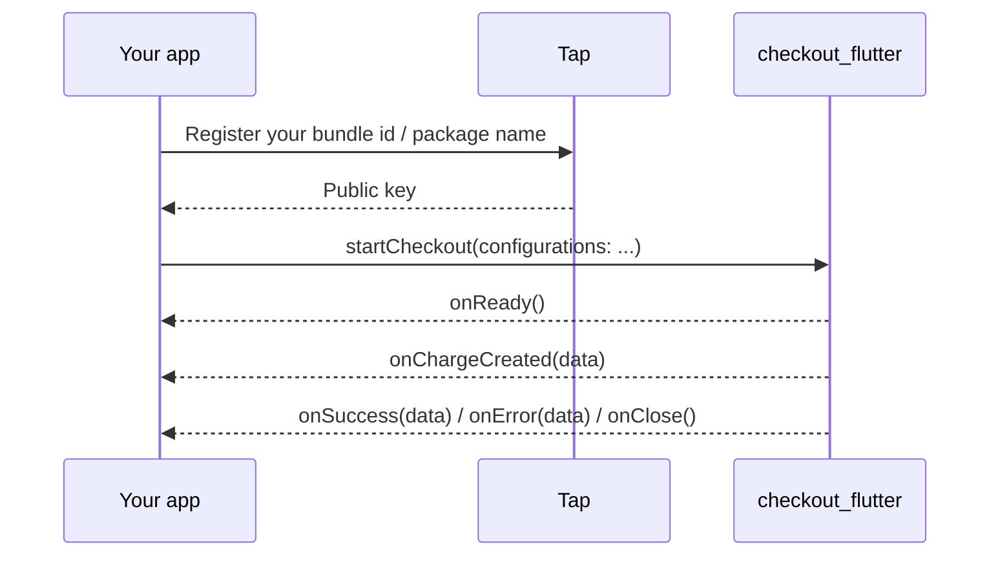

# checkout_flutter

Tap Payments' checkout for Flutter. Present a full Tap checkout from your app on iOS and Android, collect a card or local payment method, and get the result back through a few callbacks.

The plugin wraps the native SDKs, [Checkout-IOS](https://github.com/Tap-Payments/Checkout-IOS) and [Checkout-Android](https://github.com/Tap-Payments/Checkout-Android), so the checkout looks and behaves exactly like it does in a native app.


- [Requirements](#requirements)
- [How it works](#how-it-works)
- [Installation](#installation)
- [Permissions](#permissions)
- [Quick start](#quick-start)
- [Callbacks](#callbacks)
- [Configuration reference](#configuration-reference)
- [Charge vs Authorize](#charge-vs-authorize)
- [Sandbox vs production](#sandbox-vs-production)
- [Example apps](#example-apps)
- [Tests](#tests)
- [Upgrading from 1.0.4 or earlier](#upgrading-from-104-or-earlier)
- [Troubleshooting](#troubleshooting)

## Requirements

| | iOS | Android |
|---|---|---|
| Native SDK | Checkout-IOS **1.0.7** | Checkout-Android **1.0.9** |
| Minimum OS | iOS 15.0 | API 24 (Android 7.0) |
| Dependency manager | Swift Package Manager or CocoaPods | Gradle (JitPack) |
| Flutter | 3.24 or later for Swift Package Manager; any 3.x with CocoaPods | 3.x |

> [!NOTE]
> Current release: **1.0.5**. Replace the version in the snippets below with the latest one on the [releases page](https://github.com/Tap-Payments/Checkout-Flutter/tags).

## How it works



## Installation

Add the plugin to your `pubspec.yaml`:

```yaml
dependencies:
  checkout_flutter:
    git:
      url: https://github.com/Tap-Payments/Checkout-Flutter.git
      ref: 1.0.5
```

```bash
flutter pub get
```

### iOS with Swift Package Manager

The plugin ships a `Package.swift`, so Flutter can pull in Checkout-IOS with Swift Package Manager instead of CocoaPods. Turn it on once on your machine (it is on by default in newer Flutter releases):

```bash
flutter config --enable-swift-package-manager
```

Then build or run as usual. Flutter adds the packages to your Xcode project on the next build; there is nothing else to change. Set the iOS deployment target of the Runner target to **15.0** or later.

### iOS with CocoaPods

If Swift Package Manager is off (or you opt a project out with `disable-swift-package-manager: true` under `flutter:` in `pubspec.yaml`), Flutter uses CocoaPods. Set the platform in `ios/Podfile`:

```ruby
platform :ios, '15.0'
```

> [!TIP]
> On Xcode 27, some transitive pods still declare a minimum below iOS 15 and fail to build. Add the deployment target line to the `post_install` hook of your Podfile (as in [`example/cocoapods_example/ios/Podfile`](example/cocoapods_example/ios/Podfile)):
>
> ```ruby
> post_install do |installer|
>   installer.pods_project.targets.each do |target|
>     flutter_additional_ios_build_settings(target)
>     target.build_configurations.each do |config|
>       config.build_settings['IPHONEOS_DEPLOYMENT_TARGET'] = '15.0'
>     end
>   end
> end
> ```

### Android

Checkout-Android is published on [JitPack](https://jitpack.io/#Tap-Payments/Checkout-Android). The plugin adds the JitPack repository to your project; if your build sets `repositoriesMode` to `FAIL_ON_PROJECT_REPOS`, add it yourself in `android/settings.gradle(.kts)`:

```kotlin
dependencyResolutionManagement {
    repositories {
        google()
        mavenCentral()
        maven("https://jitpack.io")
    }
}
```

In `android/app/build.gradle(.kts)`, set `minSdk = 24` (or higher) and `compileSdk = 36` (Checkout-Android 1.0.9 is built against API 36; older Flutter templates default to 35).

The plugin includes its own R8 / ProGuard keep rules, so release builds that shrink code need no extra rules.

## Permissions

**iOS.** Add a camera usage description to `ios/Runner/Info.plist`. It is required by the card scanner; without it iOS terminates the app when the scanner opens.

```xml
<key>NSCameraUsageDescription</key>
<string>Used to scan your card.</string>
```

**Android.** The SDK's manifest already declares what it needs, and it is merged into your app automatically:

| Permission | Used for |
|---|---|
| `INTERNET`, `ACCESS_WIFI_STATE` | Loading the checkout |
| `CAMERA` | The card scanner. The SDK asks for it at runtime when the scanner opens. |
| `NFC` | Reading a card with NFC (`cardOptions.alternativeCardInputs.cardNFC`) |

## Quick start

Build a configuration map and call `startCheckout`:

```dart
import 'package:checkout_flutter/checkout_flutter.dart';

Future<void> pay() async {
  final started = await startCheckout(
    configurations: {
      'gateway': {'publicKey': 'pk_test_YOUR_PUBLIC_KEY'},
      'language': 'en',
      'themeMode': 'light',
      'paymentType': 'ALL',
      'supportedPaymentMethods': 'ALL',
      'supportedCurrencies': 'ALL',
      'selectedCurrency': 'KWD',
      'amount': 5,
      'customer': {
        'firstName': 'Jane',
        'lastName': 'Doe',
        'email': 'jane@example.com',
        'phone': {'countryCode': '965', 'number': '55567890'},
      },
      'order': {
        'currency': 'KWD',
        'amount': 5,
        'items': [
          {'name': 'Item', 'description': 'Item description', 'quantity': 1, 'amount': 5, 'currency': 'KWD'},
        ],
      },
      'transaction': {
        'mode': 'charge',
        'charge': {
          'saveCard': true,
          'threeDSecure': true,
          'redirect': {'url': 'https://example.com/checkout/return'},
        },
      },
    },
    onReady: () {},
    onChargeCreated: (data) => print('charge created: $data'),
    onSuccess: (data) => print('success: $data'),
    onError: (data) => print('error: $data'),
    onClose: () {},
  );
  if (!started) print('The checkout could not be started (for example, no public key).');
}
```

Nested objects are `Map`s and arrays are `List`s; the plugin passes them to the native SDK unchanged.

> [!NOTE]
> `startCheckout` does not validate the configuration. Invalid or missing values are reported by the Tap backend inside the checkout or through `onError`. It returns `false` only when the native side rejects the call (no public key, no activity on Android).

> [!TIP]
> Starting a new checkout while one is still open replaces it, on both platforms. Only the callbacks of the latest `startCheckout` are called.

## Callbacks

All callbacks are optional and the same on iOS and Android. `data` is a **JSON string** produced by the checkout; parse it with `jsonDecode`.

| Callback | Fires when | `data` | Checkout dismissed |
|---|---|---|---|
| `onReady()` | The checkout finished loading and is ready for input. | none | No |
| `onChargeCreated(data)` | A charge/authorization object was created. | JSON string | No |
| `onSuccess(data)` | The checkout completed, including after a 3D Secure challenge. | JSON string (after 3DS: the charge id) | Yes, before the callback |
| `onError(data)` | The checkout failed, a network step failed, or (iOS) the camera permission was denied. | JSON string (some native errors are plain text) | Yes, before the callback |
| `onClose()` | The user closed the checkout. | none | Yes, before the callback |

They map to the native callbacks like this:

| Flutter | Checkout-IOS (`CheckoutSDKDelegate`) | Checkout-Android (`TapCheckoutStatusDelegate`) |
|---|---|---|
| `onReady` | `onReady()` | `onCheckoutReady()` |
| `onChargeCreated` | `onChargeCreated(data:)` | `onCheckoutChargeCreated(data)` |
| `onSuccess` | `onSuccess(data:)` | `onCheckoutSuccess(data)` |
| `onError` | `onError(data:)` | `onCheckoutError(error)` |
| `onClose` | `onClose()` | `onCheckoutcancel()` |

> [!TIP]
> Treat `onSuccess` as "the flow finished". After 3D Secure its payload is `{"chargeId":"chg_..."}`; confirm the final payment status on your server with the Retrieve Charge API ([Charges reference](https://developers.tap.company/reference/charges)) (`GET /v2/charges/{charge_id}`).

## Configuration reference

The configuration is a `Map<String, dynamic>` that mirrors the Tap web checkout demo. Dotted paths mean nested maps (`gateway.publicKey` is `{'gateway': {'publicKey': ...}}`). Defaults are the values the example apps send, which match the web demo; "omit" means the key is not sent. The native SDKs read only `gateway.publicKey`, `language` and (Android) `themeMode` themselves; everything else is forwarded to the Tap backend.

### SDK and gateway

| Key | Type | Values | Default |
|---|---|---|---|
| `gateway.publicKey` | String | Your Tap public key (`pk_test_...` / `pk_live_...`). Required. | none |
| `gateway.merchantId` | String | Merchant id associated with the key | omit |
| `hashString` | String | Hash generated on your server (see [Sandbox vs production](#sandbox-vs-production)) | `""` |
| `language` | String | `en`, `ar`, or `dynamic` (Android only: the SDK replaces it with the device language) | `en` |
| `themeMode` | String | `light`, `dark`, `light_mono`, `dark_colored`, or `dynamic` (Android only: the device's light/dark mode) | `light` |
| `checkoutMode` | String | `popup` (bottom sheet), `page` (full screen) | `popup` |
| `paymentType` | String | `ALL`, `WEB`, `CARD`, `DEVICE` | `ALL` |
| `supportedPaymentMethods` | String or List | `"ALL"` or any of `AMERICAN_EXPRESS`, `APPLE_PAY`, `BENEFIT`, `BENEFITPAY`, `CAREEMPAY`, `FAWRY`, `GOOGLE_PAY`, `KNET`, `MADA`, `MASTERCARD`, `MEEZA`, `OMANNET`, `PAYPAL`, `POST_PAY`, `NAPS`, `STC_PAY`, `TABBY`, `VISA` | `"ALL"` |
| `selectedCurrency` | String | `KWD`, `BHD`, `SAR`, `AED`, `OMR`, `EGP`, `GBP`, `USD`, `EUR` | `SAR` |
| `supportedCurrencies` | String or List | `"ALL"`, `"AUTO"`, or a list of currency codes | `"ALL"` |
| `supportedRegions` | List | `LOCAL`, `REGIONAL`, `GLOBAL` | omit |
| `supportedCountries` | List | ISO alpha-2 country codes | omit |
| `supportedPaymentTypes` | List | `CARD`, `DEVICE_WALLET`, `EXPRESS_CHECKOUT_WALLET`, `PASS_THRU_WALLET`, `STORED_VALUE_WALLET`, `CASH_WALLET`, `BNPL` | omit |
| `supportedSchemes` | List | `BENEFIT`, `VISA`, `AMEX`, `MASTERCARD`, `MADA`, `MEEZA`, `OMANNET` | omit |
| `isApplePayAvailableOnClient` | bool | | `true` |
| `open` | bool | Always `true` (the web SDK adds it too) | `true` |

### Customer

| Key | Type | Notes |
|---|---|---|
| `customer.id` | String | Existing Tap customer id. Omit if empty. |
| `customer.firstName` | String | Required. |
| `customer.lastName` | String | Required unless `customer.id` is set. |
| `customer.email` | String | |
| `customer.phone.countryCode` | String | For example `965`. |
| `customer.phone.number` | String | Digits and `+`, at least 8 characters. |

### Card options

| Key | Type | Values | Default |
|---|---|---|---|
| `cardOptions.showBrands` | bool | | `true` |
| `cardOptions.showLoadingState` | bool | | `false` |
| `cardOptions.collectHolderName` | bool | | `true` |
| `cardOptions.preLoadCardName` | String | Pre-filled card holder name | `""` |
| `cardOptions.cardNameEditable` | bool | | `true` |
| `cardOptions.cardFundingSource` | String | `all`, `credit`, `debit` | `all` |
| `cardOptions.saveCardOption` | String | `all`, `merchant`, `tap`, `none` | `all` |
| `cardOptions.forceLtr` | bool | | `false` |
| `cardOptions.alternativeCardInputs.cardScanner` | bool | Shows the native card scanner button (uses the camera; iOS needs `NSCameraUsageDescription`). | omit |
| `cardOptions.alternativeCardInputs.cardNFC` | bool | Shows the NFC card reader button. Android only: Checkout-IOS always forces it to `false`. | omit |

### Order

| Key | Type | Notes |
|---|---|---|
| `amount` | num | Order total: sum of `amount * quantity` over items, minus the discount. Must be greater than 0. |
| `order.id` | String | Your order reference. Default `""`. |
| `order.currency` | String | Same as `selectedCurrency`. |
| `order.amount` | num | Same value as top-level `amount`. |
| `order.items[]` | List | At least one item. |
| `order.items[].name` | String | Min 2 characters. |
| `order.items[].description` | String | Min 2 characters. |
| `order.items[].quantity` | int | Required. |
| `order.items[].amount` | num | `>= 0`. |
| `order.items[].currency` | String | Same as `selectedCurrency`. |
| `order.discount.type` | String | `F` (fixed) or `P` (percentage). Send only when the value is greater than 0. |
| `order.discount.value` | num | Discount value. |

> [!TIP]
> Round amounts to the currency's decimals before sending them (`0.1 + 0.2` is `0.30000000000000004` as a `double`). The example apps round to 3 decimals; see `CheckoutSettings.jsonNumber` in [`example/shared`](example/shared/lib/src/checkout_settings.dart).

### Transaction

| Key | Type | Values | Default |
|---|---|---|---|
| `transaction.mode` | String | `charge`, `authorize` | `charge` |
| `transaction.<mode>.threeDSecure` | bool | | `true` |
| `transaction.<mode>.saveCard` | bool | | `true` |
| `transaction.<mode>.redirect.url` | String | URL the 3D Secure / redirect flow returns to | none |
| `transaction.<mode>.auto.type` | String | `CAPTURE`, `VOID` (see [Charge vs Authorize](#charge-vs-authorize)) | `VOID` |
| `transaction.<mode>.auto.time` | int | Hours before the automatic action | `100` |
| `transaction.<mode>.agreement.type` | String | `SCHEDULED`, `UNSCHEDULED` (recurring / saved agreements) | omit |
| `transaction.<mode>.agreement.amount_variability` | String | `FIXED`, `VARIABLE` (scheduled only) | `FIXED` |
| `transaction.<mode>.subscription.type` | String | `SCHEDULED` (not sent when the agreement type is `UNSCHEDULED`) | `SCHEDULED` |
| `transaction.<mode>.subscription.amount_variability` | String | `FIXED`, `VARIABLE` | `FIXED` |
| `transaction.<mode>.subscription.txn_count` | int | Number of payments; `0` means undefined | `0` |
| `transaction.<mode>.airline.reference.booking` | String | Airline booking reference. `airline` is sent by default; leave it out to disable it. | `""` |

`<mode>` is the value of `transaction.mode`.

## Charge vs Authorize

`transaction.mode` decides what the checkout creates:

- `charge`: payment is captured immediately.
- `authorize`: funds are reserved and captured or voided later.

The settings for the transaction live in a sub-object **named after the mode**: `transaction.charge` for charges, `transaction.authorize` for authorizations. The inner fields are identical; only the key name changes. Use exactly one.

For authorizations, `auto` controls what happens if you do nothing:

- `auto.type`: `CAPTURE` captures the authorization automatically, `VOID` releases it.
- `auto.time`: hours to wait before that automatic action is applied (`100` in the web demo).

**Charge**

```json
{
  "transaction": {
    "mode": "charge",
    "charge": {
      "saveCard": true,
      "threeDSecure": true,
      "redirect": { "url": "https://example.com/checkout/return" }
    }
  }
}
```

**Authorize**

```json
{
  "transaction": {
    "mode": "authorize",
    "authorize": {
      "saveCard": true,
      "threeDSecure": true,
      "auto": { "type": "VOID", "time": 100 },
      "redirect": { "url": "https://example.com/checkout/return" }
    }
  }
}
```

The plugin handles both modes the same way and fires the same callbacks. To capture or void an authorization manually, call the Tap API **from your server** using the authorization id returned in the callback payload. See [developers.tap.company](https://developers.tap.company).

## Sandbox vs production

| | Sandbox | Production |
|---|---|---|
| Public key | `pk_test_...` | `pk_live_...` |
| Money moves | No | Yes |

- Switch environments by changing `gateway.publicKey`. The Tap backend picks sandbox or production from the key.
- Use only your **public** key in the app. Never embed a secret key (`sk_...`) in a mobile binary; it can be extracted.
- `hashString` must be generated on **your server** and passed to the app. Follow the [Tap documentation](https://developers.tap.company) for how to compute it; do not compute it with a secret key on the device.
- Keep keys out of source control: load them from build configuration (for example `--dart-define`) or a remote config, not hard-coded literals in committed files.

## Example apps

Two apps live in [`example`](example). They run the same Dart code (the [`example/shared`](example/shared) package) and differ only in how iOS pulls in Checkout-IOS:

| App | iOS integration | Run |
|---|---|---|
| [`example/spm_example`](example/spm_example) | Swift Package Manager | `cd example/spm_example && FLUTTER_SWIFT_PACKAGE_MANAGER=true flutter run` (or turn it on once with `flutter config --enable-swift-package-manager`) |
| [`example/cocoapods_example`](example/cocoapods_example) | CocoaPods (`disable-swift-package-manager: true` in its `pubspec.yaml`) | `cd example/cocoapods_example && flutter run` |

On Android both use Gradle and behave the same.

The screens match the native example apps: a summary of what the next checkout will do, the main settings, and every callback as a card that expands to its full payload (long press copies it). **Settings** mirrors every input of the Tap web demo and has a **Show configuration JSON** view that prints the exact map passed to `startCheckout`.

Before running, give the apps your Tap sandbox public key, either:

- on the command line: `flutter run --dart-define=TAP_PUBLIC_KEY=pk_test_...`, or
- in [`example/shared/lib/src/keys.dart`](example/shared/lib/src/keys.dart), replacing the placeholder `YOUR_TAP_PUBLIC_KEY`, or
- in the app, under Settings > SDK Configuration > Public Key.

To switch between several sandbox keys, copy [`example/shared/assets/keys.local.example.json`](example/shared/assets/keys.local.example.json) to `example/shared/assets/keys.local.json` (gitignored) and fill it in; debug builds then show **Saved Keys** in Settings.

Both apps use the bundle id `com.example.checkoutFlutterExample` and the package name `com.example.checkout_flutter_example`; register them with Tap for your key, or change them to ones your key is registered for.

**Sandbox test card (3D Secure)**

| Card number | Expiry | CVV |
|---|---|---|
| 4508 7500 1574 1019 | 01/39 | 100 |

## Tests

| Tests | What they check | Run |
|---|---|---|
| [`test/`](test) | The Dart API: arguments sent to the native side, every callback routed to its Dart function. | `flutter test` |
| [`android/src/test`](android/src/test) | The Android plugin: argument checks and the map handed to Checkout-Android. | `cd example/cocoapods_example/android && ./gradlew :checkout_flutter:testDebugUnitTest` |
| [`example/shared/test`](example/shared/test) | The configuration the example apps send matches this README's defaults and mapping rules (same cases as the native `CheckoutSettingsTests`), plus the example screens. | `cd example/shared && flutter test` |
| `example/*/integration_test` | On a simulator or emulator against the Tap sandbox: the README values give the expected callbacks (port of the native `ReadmeConfigurationTests`). | `cd example/spm_example && flutter test integration_test --dart-define=TAP_PUBLIC_KEY=pk_test_...` |

## Upgrading from 1.0.4 or earlier

- iOS now needs **iOS 15.0** (Checkout-IOS 1.0.7). Raise `platform :ios` in your Podfile, or the Runner deployment target with Swift Package Manager.
- On Android, closing the checkout now calls **`onClose`**, like on iOS. `onCancel` still works but is deprecated; move to `onClose`.
- `onChargeCreated` is new and fires on both platforms.
- You can remove the Checkout-Android ProGuard rules you copied into your app; the plugin applies them itself.

## Troubleshooting

| Problem | Fix |
|---|---|
| CocoaPods build fails on Xcode 27 with an `IPHONEOS_DEPLOYMENT_TARGET` error | Set `platform :ios, '15.0'` and add the `post_install` lines from [iOS with CocoaPods](#ios-with-cocoapods). |
| `CocoaPods could not find compatible versions for pod "Checkout-IOS"` | Run `pod repo update`, then `pod install` in `ios/`. |
| Swift Package Manager is not used, CocoaPods still runs | Turn it on with `flutter config --enable-swift-package-manager` and check that `pubspec.yaml` does not set `disable-swift-package-manager: true`. |
| iOS app quits right at launch; the log says `UIScene life cycle is required for apps built with this SDK` | Apps built with Xcode 27 (iOS 27 SDK) must use scenes. On a Flutter release that ships `FlutterSceneDelegate` (3.41 does), migrate the Runner to it; on older ones such as 3.32, copy `SceneDelegate.swift`, `AppDelegate.swift` and the `UIApplicationSceneManifest` entry of `Info.plist` from [`example/spm_example/ios/Runner`](example/spm_example/ios/Runner). |
| App crashes when tapping the card scanner (iOS) | Add `NSCameraUsageDescription` to `Info.plist`. |
| Camera permission denied | iOS: the checkout closes and `onError` fires with `{"error":"The user didn't approve accessing the camera."}`. Android: the scanner cannot open. Ask the user to allow the camera in the system settings. |
| `Could not find com.github.Tap-Payments:Checkout-Android` | Add the JitPack repository; see [Android](#android). |
| The checkout takes long to appear the first time | The page and its assets load from Tap's CDN; on a slow network the first `onReady` can take a while. Check connectivity. |
| Blank checkout, nothing happens | Check connectivity and that `gateway.publicKey` is valid. |
| `startCheckout` returns `false` | The native side rejected the call; the reason is printed to the debug console (`checkout_flutter: could not start the checkout`). Usually the public key is missing. |
